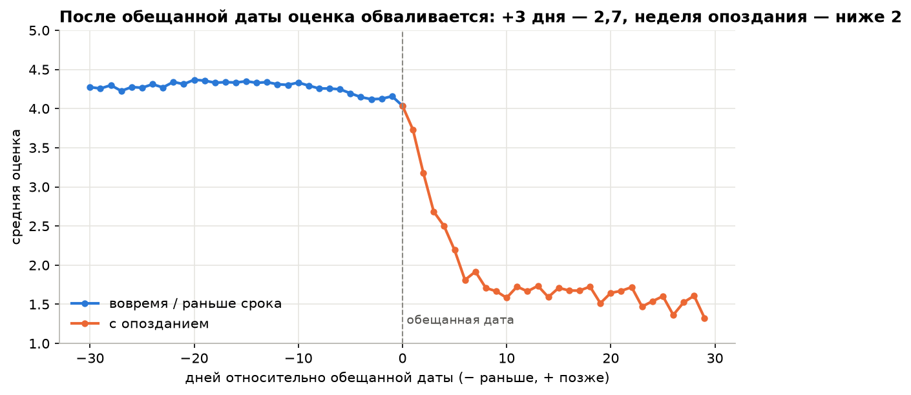
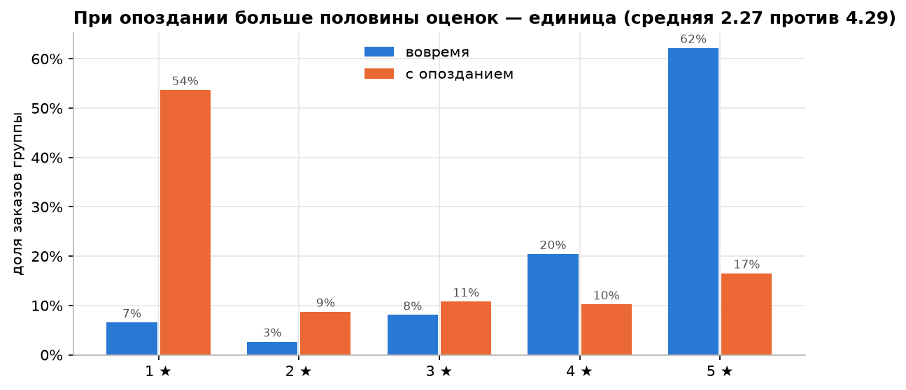
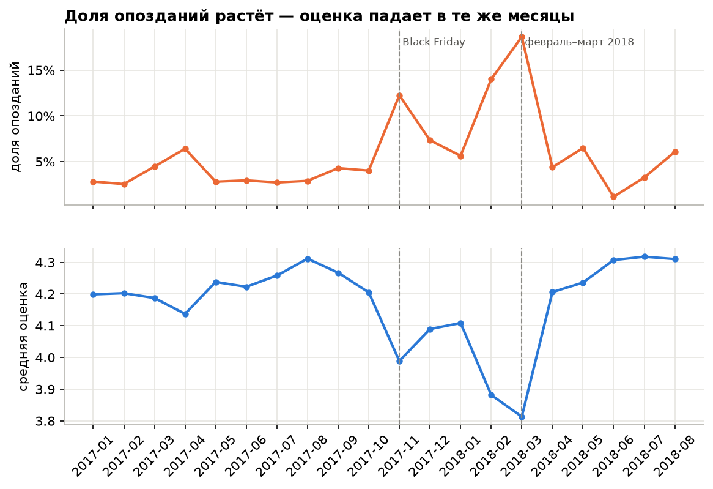
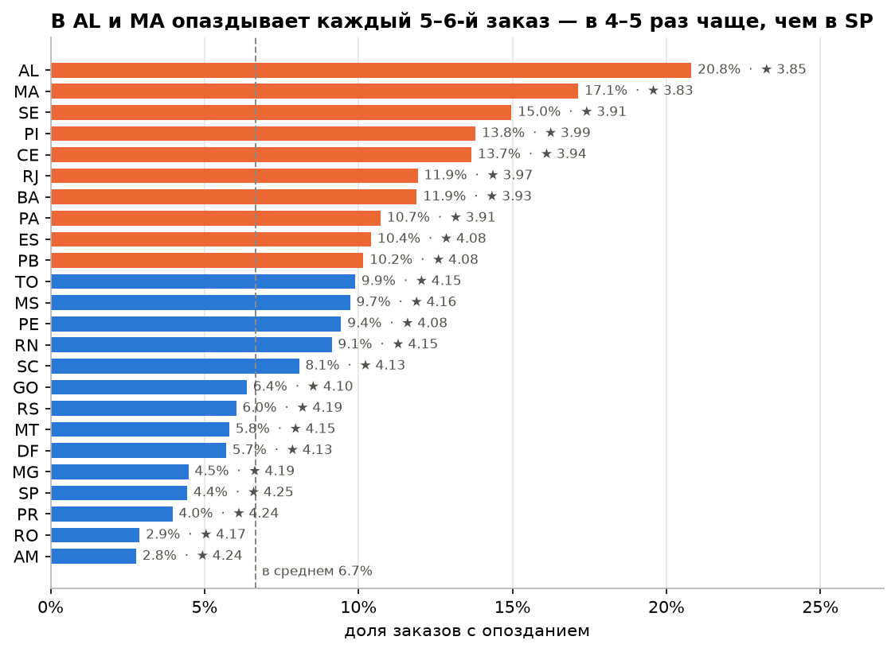

# Olist: почему покупатели ставят плохие оценки

Портфолио-проект по аналитике данных: SQL → Python → Excel/VBA на открытом датасете бразильского маркетплейса Olist.



## Задача (легенда)

Я аналитик в отделе качества маркетплейса Olist. Средняя оценка покупателей проседает, и руководитель спрашивает:
**что именно портит отзывы, где это происходит и что с этим делать?**

Нужно:
1. найти главный драйвер плохих оценок и измерить его эффект в цифрах;
2. показать, где (месяцы, штаты, категории, продавцы) проблема сконцентрирована;
3. дать руководителю дашборд, а отделу качества — инструмент, который за один клик готовит
   письмо-претензию продавцу с плохими показателями.

## Данные и инструменты

**Данные:** [Brazilian E-Commerce Public Dataset by Olist](https://www.kaggle.com/datasets/olistbr/brazilian-ecommerce) (Kaggle) —
~99 тыс. заказов за сентябрь 2016 — октябрь 2018: заказы, товары, отзывы, клиенты, продавцы, платежи.
В анализе: 96 470 доставленных заказов с датой доставки, из них 95 824 с отзывом.

**Инструменты:**

| Этап | Что использовано |
|---|---|
| SQL | SQLite, CTE, `JOIN`, `CASE`, оконные функции `RANK()` и `COUNT() OVER` |
| Python | pandas, matplotlib, Jupyter |
| Excel | сводные таблицы с вычисляемыми полями, срезы, сводные диаграммы, дашборд |
| VBA | макрос-генератор письма продавцу + черновик в Outlook |

**Ключевые договорённости:**
- *опоздание* — дата доставки клиенту позже обещанной (`order_estimated_delivery_date`), сравнение по дням;
- *выручка* — сумма цен товаров без стоимости доставки;
- у 547 заказов несколько отзывов — оценка усреднена до уровня заказа, чтобы такие заказы не весили больше;
- проверка данных (пропуски, дубли, логика дат) и что с найденным сделано — в разделе 1 [`analysis.ipynb`](analysis.ipynb).

## Главные выводы

**1. Опоздание — главный драйвер плохих отзывов.**
Заказы, доставленные с опозданием, получают в среднем **2,27 балла против 4,29** у доставленных вовремя.
Доля оценок 1–2 вырастает с **9,2% до 62,4%** — опоздание превращает почти любой отзыв в жалобу.
Опаздывает всего 6,7% заказов, но они дают около трети всех плохих оценок.



**2. Покупатель оценивает выполнение обещания, а не скорость.**
Привезти на 5 или на 20 дней раньше срока — одна и та же оценка (~4,2–4,3).
После обещанной даты оценка обваливается: **+3 дня — 2,68, неделя опоздания — ниже 2**.

**3. Опоздания сезонны и совпадают с провалами оценки.**
Пики — **ноябрь 2017 (Black Friday, 12,3% опозданий)** и **февраль–март 2018 (14,0% и 18,7%)**.
В марте 2018 средняя оценка опустилась до 3,81 при обычных ~4,2–4,3.
Помесячная корреляция доли опозданий и средней оценки — **−0,92**.



**4. Опоздания географичны: северо-восток страдает в 4–5 раз чаще Сан-Паулу.**
В Алагоасе (AL) опаздывает **20,8%** заказов, в Мараньяне (MA) — 17,1%, в Сан-Паулу (SP) — 4,4%.
Обещанные сроки для дальних штатов не учитывают реальную логистику.



**5. Проблема концентрирована у небольшой группы продавцов.**
Из 623 продавцов с ≥ 30 оценёнными заказами у **34 доля оценок 1–2 вдвое выше нормы платформы** (12,8%),
у 47 — вдвое выше норма опозданий. У худшего продавца 61% оценок — 1–2.
Доля плохих отзывов и доля опозданий у продавцов связаны (корреляция 0,53).

## Рекомендации бизнесу

| Что сделать | Почему |
|---|---|
| **Пересчитать обещанную дату доставки** для штатов северо-востока (AL, MA, SE, PI, CE) и для пиковых месяцев — закладывать запас по фактическим срокам | Клиенту важно не «быстро», а «как обещали»: ранняя доставка почти не добавляет баллов, а опоздание на 3 дня отнимает 1,6 балла. Честный срок дешевле ускорения логистики |
| **Готовить логистику к пикам** (Black Friday, начало года): заранее договариваться о мощностях перевозчиков, временно увеличивать обещанный срок | В ноябре 2017 и марте 2018 доля опозданий выросла в 3–6 раз, и вслед за ней упала оценка |
| **Ввести ежемесячный мониторинг продавцов** по доле оценок 1–2 и доле опозданий, с порогом «вдвое выше нормы платформы» | 34–47 продавцов дают непропорционально много плохих отзывов; их видно по запросу 6 и листу «Продавцы» |
| **Отправлять продавцам уведомления с цифрами и сроком исправления**, при отсутствии улучшений — ограничивать продвижение | Письмо с конкретными показателями и дедлайном работает лучше общего предупреждения; в `report.xlsm` оно формируется за один клик |
| **Проактивно извиняться за опоздание** (уведомление + бонус/купон, если заказ не успевает к сроку) | Даже при опоздании 17% клиентов ставят 5 звёзд — реакция на опоздание управляема |

## Excel-отчёт и VBA

`report.xlsm`:
- **Дашборд** — KPI-плитки (выручка, заказы, средняя оценка, доля опозданий, доля оценок 1–2), 6 сводных диаграмм
  и срезы **Месяц / Штат / Категория**, которые фильтруют всё одновременно;
- **Сводные** — сводные таблицы с вычисляемыми полями (доли считаются корректно при любом срезе);
- **Продавцы** — таблица из запроса 9, выбор продавца и кнопка **«Сформировать письмо»**: макрос собирает
  письмо-уведомление с долей плохих отзывов, процентом опозданий, сравнением с нормой платформы, уровнем риска
  и сроком исправления (по умолчанию 30 дней), выводит его на лист «Письмо» и по желанию открывает черновик в Outlook
  (письмо не отправляется автоматически);
- **Данные** — факт-таблица (запрос 8), **Справка** — как считаются метрики.

Нормы платформы, срок исправления и подпись редактируются в ячейках B4:B6 и E4 листа «Продавцы».

## Структура репозитория

```
olist-review-analysis/
├── README.md              ← этот файл
├── queries.sql            ← 7 аналитических запросов + 2 выгрузки для Excel
├── analysis.ipynb         ← проверка данных, опоздание vs оценка, главные находки
├── report.xlsm            ← Excel с дашбордом и VBA-кнопкой
├── images/                ← графики для README (генерируются ноутбуком)
├── vba/QualityLetter.bas  ← исходник VBA-модуля
├── load_data.py           ← загрузка CSV в SQLite (olist.db)
├── make_notebook.py       ← генератор analysis.ipynb
├── build_report.py        ← сборка report.xlsm из SQL-выгрузок
├── test_macro.py          ← автотест VBA-письма (худший и лучший продавец)
└── data/                  ← CSV с Kaggle (не хранится в репозитории)
```

## Как воспроизвести

```bash
pip install pandas matplotlib jupyter openpyxl pywin32
```

1. Скачайте датасет с Kaggle и распакуйте CSV в `data/`.
2. `python load_data.py` — создаст `olist.db`.
3. Откройте `queries.sql` в любом SQLite-клиенте (DB Browser, DBeaver) или выполните ноутбук `analysis.ipynb`.
4. `python build_report.py` — пересоберёт `report.xlsm` (нужен Excel под Windows).
